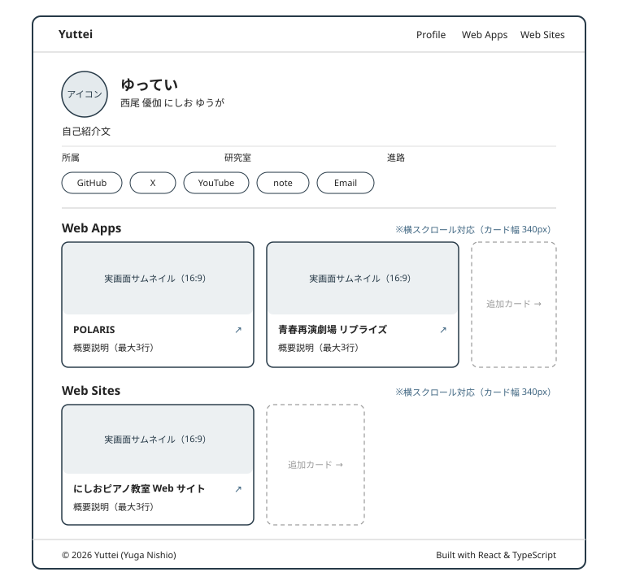

# ポートフォリオサイト仕様書

本文書は、ゆってい（Yuttei / 西尾 優伽）の個人ポートフォリオサイト（パッケージ名：`portfolio`）の画面構成、データモデル、動作仕様、テスト方針、および公開前の確認事項を定義する。作品やプロフィールの日常的な更新手順は [content-update.md](content-update.md) にまとめる。

---

## 1. 概要

自作の Web アプリケーションと Web サイトを1ページにまとめて掲載し、各カードをクリックすると該当ページを新しいブラウザタブで開く静的サイトである。余白を活かしたミニマルな構成とし、ヘッダー・プロフィール・Web Apps・Web Sites・フッターの順に配置する。

- **サイトの構成**：
  - **ヘッダー**：ブランド名（`Yuttei`）とページ内セクション（`Profile` / `Web Apps` / `Web Sites`）への移動リンクを上部に固定表示
  - **プロフィール**：カード枠を使わずページ背景上へ直接配置し、円形アイコン・メイン表示名（`ゆってい`）・サブ本名（`西尾 優伽` / `にしお ゆうが`）・自己紹介・所属や研究室・SNS やメールへのリンクを表示
  - **Web Apps / Web Sites**：作品を2つの区分に分け、16:9 の実画面サムネイル・タイトル・概要説明を持つカードをそれぞれ1行の横スクロール列として配置
  - **フッター**：著作権表示（`© 2026 Yuttei (Yuga Nishio)`）と技術表記（`Built with React & TypeScript`）を配置

---

## 2. 技術構成と実行環境

開発環境は Nix Flake（[flake.nix](../flake.nix) / [packages.nix](../packages.nix)、対象プラットフォーム：`aarch64-darwin`）で管理し、フロントエンドは Vite、React、TypeScript で構築する。

| 項目 | 採用技術・設定 | 役割 |
|---|---|---|
| 開発環境管理 | Nix Flake（`git`、`gh`、`gitleaks`、`nodejs_22`、`ripgrep`、`jq`、`curl`、`shellcheck`） | 端末間で同一のツール群を再現し、初回起動時にリポジトリ設定を自動適用 |
| ビルドツール | Vite（`base: "./"`） | ローカル開発サーバー起動と、相対パス参照による静的ファイル出力（`dist/`） |
| UI ライブラリ | React 19 + TypeScript（`strict` 有効） | コンポーネント分割と型チェックによる整合性の確保 |
| アイコン | `lucide-react` およびインライン SVG | 外部リンク記号（`ExternalLink`）、メール、SNS ロゴの表示 |
| テスト | Vitest（`environment: "node"`） | データ定義の整合性と、`renderToStaticMarkup` による描画 HTML の検証 |
| コミット前検査 | `.githooks/pre-commit`（`gitleaks git --pre-commit --staged --redact`） | ステージ済み変更への機密情報混入を防止 |

### 2.1 コマンド一覧

実行時は `portfolio` ディレクトリで `nix develop` の環境に入り、次の npm スクリプトを使用する。

| コマンド | 実行内容 | 用途 |
|---|---|---|
| `npm run dev` | `vite` | ローカル開発サーバーの起動 |
| `npm run typecheck` | `tsc --noEmit` | TypeScript の型チェック |
| `npm test` | `vitest run` | データ整合性と描画 HTML の単体テスト実行 |
| `npm run build` | `tsc --noEmit && vite build` | 型チェックと `dist/` への本番ビルド生成 |
| `npm run preview` | `vite preview` | ビルド成果物（`dist/`）のローカル確認 |

---

## 3. 画面仕様

### 3.1 ヘッダー

画面上部に追従表示（`position: sticky`、`height: 64px`）し、背景を半透明のすりガラス調（`backdrop-filter: blur(10px)`）に保つ。

| 要素 | 表示内容 | 動作 |
|---|---|---|
| ブランドリンク | `Yuttei` | ページ最上部（`#top`）へスクロール |
| ナビゲーション | `Profile` / `Web Apps` / `Web Sites` | 各セクション（`#profile` / `#apps` / `#sites`）へスクロール（`scroll-margin-top: 88px` で固定ヘッダー下へ整列） |

### 3.2 プロフィールセクション

[src/data/portfolioData.ts](../src/data/portfolioData.ts) の `PROFILE_DATA` と `SOCIAL_LINKS` を読み込み、[ProfileSection.tsx](../src/components/ProfileSection.tsx) で描画する。カード枠（白背景・枠線・角丸・影）は使わずページ背景（`#fafafa`）上に直接配置し、下端の細い区切り線（`1px solid #e5e7eb`）で下の作品セクションと分ける。

| 表示項目 | 現在の表示内容 | レイアウト・仕様 |
|---|---|---|
| プロフィールアイコン | `./avatar.jpg`（`512×512` の正方形画像を円形表示） | PC 幅 `76×76px`、スマホ幅（640px 以下）`64×64px`。`avatar` 未指定時のみ `initials`（`YN`）を表示。ファビコンには同じ画像を内接円で透過切り抜きした `./favicon.png`（`256×256`）を使用 |
| メイン表示名 | `ゆってい` | `h1` 見出し（PC `1.8rem` / スマホ `1.5rem`、太字）。`@` は付けない |
| 本名・よみがな（サブ） | `西尾 優伽` / `にしお ゆうが` | メイン表示名の下に控えめなサブ行（`0.96rem` / `0.82rem`）として横並び配置 |
| 自己紹介 | Web アプリやツール制作に関する短文 | 最大幅 `68ch` で折り返し |
| 所属・研究室 | 所属（中京大学 工学部 情報工学科 4年） 研究室（伊藤秀昭研究室（伊藤ゼミ）） | 上部区切り線付きの定義リスト（`dl`）を格子配置（`repeat(auto-fit, minmax(220px, 1fr))`）し、狭い画面では縦積みへ折り返し |
| SNS・連絡先リンク | `GitHub`（`https://github.com/yuttei`） `X`（`https://x.com/Yuttei__`） `YouTube`（`https://www.youtube.com/@yuttei-d5s`） `note`（`https://note.com/nifty_bonobo9848`） `Email`（`mailto:ni83132104@gmail.com`） | 白地の丸角ボタン（`border-radius: 999px`）として横並び配置し、画面幅に応じて折り返し |

### 3.3 Web Apps / Web Sites セクション

[src/data/portfolioData.ts](../src/data/portfolioData.ts) の `WEB_APPS`（見出し：`Web Apps`、`id="apps"`）と `WEB_SITES`（見出し：`Web Sites`、`id="sites"`）を、共通コンポーネント [WorkSection.tsx](../src/components/WorkSection.tsx) でそれぞれ独立したセクションとして描画する。見出し横に操作説明のサブテキストは置かず、各カードの外部リンクアイコン（`↗`）で別タブ遷移を示す。

- **カード（[AppCard.tsx](../src/components/AppCard.tsx)）内の表示要素**：
  - **サムネイル画像**：比率 `16:9` 固定、`object-fit: cover` でトリミング、遅延読み込み（`loading="lazy"`）
  - **タイトル**：`h3` 見出しとして表示し、右端に外部リンクアイコン（`ExternalLink`）を配置
  - **概要説明**：`-webkit-line-clamp: 3` により最大3行で収め、超過時は省略記号で切り詰め
- **横スクロールの振る舞い**：
  - 各セクションのカード列（`.work-shelf`）は `display: flex` と `overflow-x: auto`、`scroll-snap-type: x proximity` で1行の横スクロール領域として構成
  - カード幅は PC・タブレット幅で `340px` 固定、幅 `640px` 以下のスマートフォンで `min(82vw, 310px)` とし、複数件ある場合に次のカードが右端に視認できる比率を確保
  - ホバー時の浮き上がり（`translateY(-3px)`）やフォーカス枠がスクロール領域の端で欠けないよう、上下左右に内側余白（`padding: 6px 4px 18px`）と相殺マージンを設定

---

## 4. リンク遷移とアクセシビリティ

- **作品カード（Web Apps / Web Sites）**：
  - カード全体を一つの `<a>` 要素として実装し、サムネイルとテキストのどちらをクリックしても対象 URL を開く構造
  - すべてのカードに `target="_blank"` と `rel="noopener noreferrer"` を付与し、新しいタブで安全に遷移
  - `aria-label` に「`{タイトル} を新しいタブで開く`」を設定し、支援技術へ遷移動作を伝達
- **SNS・連絡先リンク**：
  - `GitHub`、`X`、`YouTube`、`note` には `target="_blank"` と `rel="noopener noreferrer"` を付与
  - `Email`（`mailto:`）は既定のメールクライアントを起動するため、`target="_blank"` を付与しない
- **キーボード操作**：
  - `a:focus-visible` に青色のフォーカスリング（`outline: 2px solid #2563eb`、`outline-offset: 3px`）を表示

---

## 5. データモデル

型定義は [src/types/portfolio.ts](../src/types/portfolio.ts)、掲載データは [src/data/portfolioData.ts](../src/data/portfolioData.ts) に分離し、コンポーネントを変更せずに掲載内容を更新する構成とする。

### 5.1 `Profile` の項目定義

| フィールド名 | 型 | 必須 | 説明 |
|---|---|---|---|
| `name` | `string` | 必須 | サブ表示する本名 |
| `reading` | `string` | 必須 | 本名のよみがな |
| `handle` | `string` | 必須 | プロフィール上部のメイン表示名（`h1`） |
| `initials` | `string` | 必須 | `avatar` 未指定時に円形バッジへ表示するイニシャル |
| `avatar` | `string` | 任意 | `public/` 配下のアイコン画像パス（例：`./avatar.jpg`） |
| `bio` | `string` | 必須 | 自己紹介文 |
| `details` | `ProfileItem[]` | 必須 | 所属・研究室などの `{ label, value }` 配列 |

### 5.2 `SocialLink` の項目定義

| フィールド名 | 型 | 必須 | 説明 |
|---|---|---|---|
| `label` | `string` | 必須 | ボタンに表示する名称 |
| `url` | `string` | 必須 | 遷移先 URL または `mailto:` アドレス |
| `kind` | `"github" \| "x" \| "youtube" \| "note" \| "email"` | 必須 | 表示アイコンと別タブ遷移の有無を決める識別子 |
| `isPlaceholder` | `boolean` | 任意 | 仮 URL の識別に使う任意フラグ |

### 5.3 `WebAppItem` の項目定義（`WEB_APPS` / `WEB_SITES` 共通）

| フィールド名 | 型 | 必須 | 説明 |
|---|---|---|---|
| `id` | `string` | 必須 | `WEB_APPS` と `WEB_SITES` を通じて重複しない一意な識別子 |
| `title` | `string` | 必須 | カードに表示するタイトル |
| `description` | `string` | 必須 | 1〜3行に収める短い概要説明 |
| `url` | `string` | 必須 | 別タブで開く公開先 URL（`http://` または `https://` で開始） |
| `thumbnail` | `string` | 必須 | `public/` 配下の 16:9 画像パス（例：`./thumbnails/polaris.jpg`） |
| `isPlaceholder` | `boolean` | 任意 | 仮 URL の識別に使う任意フラグ |

作品追加や画像差し替えの具体的なコマンドと作業手順は [content-update.md](content-update.md) を参照する。

---

## 6. テスト方針

過剰なテストを避け、サイトの核となるデータ整合性と出力 HTML だけを [src/\_\_tests\_\_/portfolio.test.tsx](../src/__tests__/portfolio.test.tsx) で検証する。

| テスト項目 | 確認内容 |
|---|---|
| `WEB_APPS` / `WEB_SITES` の整合性 | 両配列がそれぞれ1件以上あり、全件で `id`、`title`、`description`、`thumbnail` が空でなく、`url` が `http://` または `https://` で始まり、全作品を通じて `id` が重複しないこと |
| `SOCIAL_LINKS` の整合性 | 1件以上あり、全件で `label` と `url` が空でないこと |
| 描画 HTML と別タブ遷移属性 | `App` の出力 HTML にメイン表示名（`handle`）、本名（`name`）、`Web Apps`、`Web Sites` が含まれ、`@{handle}` の表記が含まれず、全作品カードに `href="{url}" target="_blank" rel="noopener noreferrer"` が付与されること |

---

## 7. 掲載中の作品と公開前の確認事項

現在（2026-11-23 時点）、公開済みの以下3件を実画面キャプチャのサムネイル（`960×540`、16:9 JPEG）付きで掲載している。

| 区分 | タイトル | 公開 URL | サムネイル |
|---|---|---|---|
| Web Apps | POLARIS — 地球の自転ビューア | `https://yuttei.github.io/earth_rotation_viewer/` | `./thumbnails/polaris.jpg` |
| Web Apps | 青春再演劇場 リプライズ | `https://novel-app-replies.pages.dev/` | `./thumbnails/novel-reprise.jpg` |
| Web Sites | にしおピアノ教室 Web サイト | `https://nishio-piano-school.pages.dev/` | `./thumbnails/nishio-piano-school.jpg` |

インターネットへ公開する前に、次の項目を確認する。

| 対象 | 現在の状態 | 公開前の確認内容 |
|---|---|---|
| 氏名・所属・研究室・メールアドレス | 本名・大学名・研究室名・Gmail アドレスを記載 | インターネット上へ公開する範囲（本名・大学名・研究室名・メールアドレスの掲載可否）を再確認 |
| デプロイ先と配信設定 | 静的ファイル出力（`dist/`、`base: "./"`）まで対応済み | GitHub Pages または Cloudflare Pages の公開先を決定し、ビルド成果物の配信を確認 |
